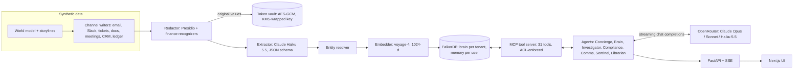
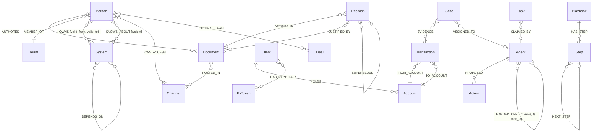

# FinanceBrain

**A FalkorDB company brain for a (synthetic) finance firm.** It ingests email, Slack, tickets, policies, meeting
transcripts, CRM notes and a transaction ledger, **pseudonymizes PII before anything reaches the graph or a model**,
and lets a team of agents answer questions with cited sources, investigate fraud and act on it (with human approval),
remember across sessions, and hand work to each other through shared graph state.

FalkorDB is the only datastore: graph, vector index, full-text index, agent memory, coordination blackboard, ACLs,
rate-limit/budget counters and the encrypted PII token vault all live in one FalkorDB server.

| | |
|---|---|
| **Live demo** | **https://d1rnt6bwyb9n59.cloudfront.net** (AWS: CloudFront → EC2, FalkorDB never exposed) |
| **Hackathon** | Graph Hacks 2026 (WeMakeDevs × FalkorDB) |
| **Tracks entered** | **T1** Agentic reasoning & actions over graphs · **T2** Agent memory & coordination · **T3** Company brain / knowledge graph |
| **Team** | Dan Tahir ([@DanTahir](https://github.com/DanTahir)), solo, with an AI coding agent ([AI disclosure](docs/AI_DISCLOSURE.md)) |
| **Data** | **All data is synthetic** (Faker + LLM-written). No real personal data anywhere. |

> Quick tour: open the live demo, pick a tenant and persona at the top, and use **Try these** (guided questions per
> track). **Reset demo** restores the pristine graph with `GRAPH.COPY`.

## What it does (one headline per track)

| Track | Ask (persona) | What happens in the graph |
|---|---|---|
| **T1** | *"Investigate the flagged $48k wire and tell me what we should do about it."* (AML analyst) | The Investigator (Claude Opus 5.5) follows the wire, hops through shared pseudonymized phone/address/device `PiiToken` nodes to a 5-client ring (`algo.WCC`), traces layered transfers to the exit counterparty, opens a `Case`, proposes freezes and a SAR, and hands the case to Compliance on the blackboard. A human approves in the **Investigations** view. |
| **T1/T3** | *"Has Project Falcon leaked outside the deal team?"* (compliance officer) | Barrier check: who each Falcon (MNPI) document reached vs. the `ON_DEAL_TEAM` wall. The same question from the engineer persona finds nothing: the deal can't even be resolved. |
| **T2** | *"Which playbook do we follow for a suspicious wire, and has it been used before?"* | The Librarian consolidated an earlier investigation into a `Playbook` → `Step` chain (procedural memory); per-user `mem__…` graphs hold sessions, facts and preferences (episodic/semantic). |
| **T3** | *"Why did we stop onboarding crypto clients?"* · *"Who owns the KYC pipeline now, and who owned it in August?"* · *"Who should I ask about ReconLegacy?"* · *"What breaks if PricingSvc goes down?"* | Decision trail (`DECIDED_IN`/`JUSTIFIED_BY`/`SUPERSEDES`), bitemporal ownership (`OWNS {valid_from, valid_to}`), who *owns* vs. who *knows* (`KNOWS_ABOUT` derived from activity), variable-length `DEPENDS_ON` blast radius, all with numbered citations to redacted source documents. |

Knowledge stays current: the corpus is split at 2026-10-01 and **Replay** in the *Ingestion & Redaction* view feeds
later days through the real pipeline (redact → extract → resolve → embed → write). The Sentinel agent then opens
cases on its own: a second ring wire, a Falcon leak in Slack, the crypto-onboarding reversal, an ownership change and
a key-person resignation.

## Architecture



- **Agents** run a hand-rolled streaming tool loop (`tool_choice: auto`, at most 8 steps) and discover every tool
  through FinanceBrain's own **MCP server** (`/mcp`, FastMCP, streamable HTTP). The auth token, never the model,
  decides tenant graph, persona and ACL.
- **ACLs are Cypher.** Retrieval only returns documents reachable through the persona's `CAN_ACCESS` / team /
  channel edges; the MNPI deal wall uses `ON_DEAL_TEAM`.
- **Explainable by construction.** Every tool call records its Cypher, parameters and returned ids (the *Cypher trace*
  panel); answers carry citations (only documents a tool actually returned count) and an evidence subgraph.
- **Privacy:** the same value always maps to the same token (`⟨PHONE_0042⟩`), so a shared phone number becomes one
  shared `PiiToken` node. That turns identifiers into graph structure without storing or showing the value. A canary
  scan of every string property in every graph must return 0 hits, and an outbound guard blocks any model or
  embedding call that contains raw PII patterns.

Deep dive for judges: [docs/ARCHITECTURE.md](docs/ARCHITECTURE.md) (component walkthrough and design decisions,
including why we moved from Amazon Bedrock to OpenRouter) · [docs/FALKORDB_NOTES.md](docs/FALKORDB_NOTES.md) (verified
FalkorDB syntax and gotchas).

## Graph data model

| Graph | Contents |
|---|---|
| `brain__<tenant>` | Company knowledge (people, teams, systems, documents, clients, accounts, transactions, deals, decisions, bitemporal facts), `PiiToken`s, ACL edges, cases/actions, blackboard tasks, playbooks, `:Meta` (embedding model, schema version) |
| `mem__<tenant>__<persona>__<visitor>` | Private per-user memory: `User`, `Session`, `Turn`, `MemoryFact`, `EntityRef`, `Preference` |
| `pristine__<tenant>` | Seed snapshot; **Reset demo** is `GRAPH.COPY` back to `brain__<tenant>` |



Indexes (from `backend/graph/schema.py`): vector (cosine, 1024-d) on `Document`, `Fact`, `Topic` and `Playbook`
embeddings in the brain graph and on `MemoryFact` and `Turn` in memory graphs; full-text on `Document` (title, text),
`Person`, `System`, `Topic`, `Deal` and `Fact` statements (plus `MemoryFact`/`Turn` text); range indexes on ids,
timestamps and statuses; unique constraints on ids.

- Full model: **[docs/DATA_MODEL.md](docs/DATA_MODEL.md)**
- Every Cypher query the app runs, generated from `backend/graph/queries.py`: **[docs/CYPHER.md](docs/CYPHER.md)**

## Results

All numbers below come from the scripts in [`evals/`](evals/); full tables in
**[evals/results/SUMMARY.md](evals/results/SUMMARY.md)**.

| Eval | Result |
|---|---|
| Golden questions (39, real agents, Claude Opus 5.5 judge) | **38/39 pass (97%)**, judge mean **4.85**/5, entity recall 100%, citation validity 100%, **0** barrier violations · T1 16/16, T2 5/5, T3 17/18 · p50 11 s · $7.15 of agent calls for the whole run ([golden.md](evals/results/golden.md)) |
| Redaction vs. injected-PII ground truth | Halcyon recall **100%** (1,345/1,345 spans), precision **99.6%**; Brightwater 100% / 100% |
| Canary scan (every string property of every graph, prod) | **0 hits** over 127,800 strings |
| Tenant isolation, information barrier, memory privacy, auth | **155/155** checks pass |
| Storyline graph checks | **19/19** per tenant |
| Retrieval (hybrid search, per-persona ACL, 11 questions) | hit@10 **72.7%**, MRR **0.51** (vector-only 0.42, full-text-only 0.19) |
| Concurrency (local laptop, Docker FalkorDB, 0 errors) | 16 readers: **1,168 reads/s**, p95 17 ms · 8 writers + 16 readers on one graph: **253 write batches/s** (12.6k rows/s) + 781 reads/s, p95 28 ms · 8 writers on 8 per-user graphs: 285 batches/s + 790 reads/s |
| Unit/integration tests | `pytest`: 81 passed |

> **How the golden number was reached.** The first full run scored 36/39 ([golden_run1.md](evals/results/golden_run1.md)).
> We diagnosed each failure in the open. Two were bad eval items: a "right now" question that was ambiguous at the
> live-feed cutoff, and a reference that contradicted the documented control-room policy for the Falcon deal record.
> One was a real product gap: the Brain agent had no `find_playbook` tool, so procedural memory was unreachable from
> Q&A. We fixed the gap, corrected the two items (see the git history of `evals/golden.json`), turned the playbook
> question into an end-to-end test (investigation, then Librarian consolidation, then recall), and re-ran the whole
> suite. The one remaining failure, `recon_who` (judge 3: it rated the ReconLegacy bus-factor risk "medium" where the
> reference says bus factor of one), passed in run 1. It is left as is rather than tuning prompts to the eval.

## Run it locally

Prerequisites: Docker, Python 3.12 via [uv](https://docs.astral.sh/uv/), Node 20+, and an
[OpenRouter](https://openrouter.ai) API key. Seeding needs **no** model calls: the extraction and embedding caches
are committed in `data/extracted/`. Questions to the agents do use the key.

```bash
# 1. Secrets (both are gitignored)
cp .env.example .env
echo "sk-or-..." > Openrouterkey.txt        # or: export OPENROUTER_API_KEY=sk-or-...

# 2. FalkorDB (Redis protocol on 127.0.0.1:6379, FalkorDB Browser on http://127.0.0.1:3001)
docker compose up -d

# 3. Backend deps
uv sync                                       # Windows: python -m uv sync

# 4. Redact the committed synthetic corpus (local vault key), then seed both tenants offline
export PYTHONPATH=.
for t in halcyon brightwater; do uv run python -m backend.redaction.run --tenant $t --reset-vault; done
uv run python -m backend.ingest.seed --tenant halcyon --tenant brightwater --drop --offline

# 5. API (REST + SSE under /api, MCP server at /mcp)
uv run uvicorn backend.api.app:app --port 8000

# 6. Web UI (proxies /api and /mcp to :8000)
cd frontend && npm install && npm run dev     # http://localhost:3000
```

Tests and evals:

```bash
uv run pytest -q                              # needs the local FalkorDB from step 2
uv run python -m evals.redaction_eval         # PII precision/recall vs injected spans
uv run python -m evals.isolation_eval         # tenant / barrier / memory / auth matrix
uv run python -m evals.retrieval_eval         # Recall@k, hit@k, MRR + ablation
uv run python -m evals.load_test              # concurrent writers + readers
uv run python -m evals.golden_eval            # 39 golden questions, real agents (~16 min, ~$7 of OpenRouter)
uv run python -m evals.report                 # -> evals/results/SUMMARY.md
```

Production deploy (AWS, idempotent AWS CLI scripts): `infra/00_check.sh` → `10_base.sh` (IAM, KMS, SSM, S3, ECR, SG,
EC2) → `20_cdn.sh` (CloudFront) → `30_deploy.sh` (build, push, SSM deploy) → `40_seed.sh` → `50_smoke.sh`. See
[docs/ARCHITECTURE.md](docs/ARCHITECTURE.md#8-deployment).

## Use it from Claude Desktop (MCP)

The agents' own MCP server is public. Mint a 24-hour **read-only** token for a tenant and persona (ACLs follow the
persona; no cases, actions or approvals over MCP; per-IP rate-limited):

```bash
curl -s -X POST https://d1rnt6bwyb9n59.cloudfront.net/api/mcp/token \
  -H 'content-type: application/json' -d '{"tenant":"halcyon","persona":"engineer"}'
# {"token":"fb1....","expires_in":86400,...}
```

Personas: `halcyon` → `ma_banker`, `compliance_officer`, `aml_analyst`, `engineer`; `brightwater` → `lender`,
`compliance_officer`, `aml_analyst`, `engineer`.

Then add the server to `claude_desktop_config.json` through [`mcp-remote`](https://www.npmjs.com/package/mcp-remote):

```json
{
  "mcpServers": {
    "financebrain": {
      "command": "npx",
      "args": ["-y", "mcp-remote", "https://d1rnt6bwyb9n59.cloudfront.net/mcp",
               "--header", "Authorization:${FB_AUTH}"],
      "env": { "FB_AUTH": "Bearer fb1.PASTE_TOKEN_HERE" }
    }
  }
}
```

Try *"Use graph_schema, then tell me what breaks if PricingSvc goes down."* Claude will call `blast_radius`,
`search_knowledge` and friends against the same graph the in-app agents use.

## Repository layout

```
backend/    FastAPI app, agents, MCP server, tools, ingestion, redaction, OpenRouter client, graph schema + queries
datagen/    world model, storylines, channel generators, PII injection with span ground truth
data/       synthetic corpus (raw + redacted JSONL), extraction and embedding cache (all labelled SYNTHETIC)
frontend/   Next.js static app (Chat, Graph Explorer, Ingestion & Redaction, Investigations, Agents, Memory)
evals/      golden questions, retrieval, redaction, isolation, load test, report -> evals/results/
infra/      AWS CLI deploy scripts, docker-compose.prod.yml, Caddyfile, Dockerfiles
docs/       DATA_MODEL, CYPHER, ARCHITECTURE, FALKORDB_NOTES, DEMO_SCRIPT, BLOG, SUBMISSION, AI_DISCLOSURE
tests/      pytest suite (runs against the local FalkorDB)
```

## Docs

| Doc | What's in it |
|---|---|
| [ARCHITECTURE](docs/ARCHITECTURE.md) | Component walkthrough, design decisions and trade-offs |
| [DATA_MODEL](docs/DATA_MODEL.md) | Graph topology, labels, relationships, indexes |
| [CYPHER](docs/CYPHER.md) | Every query, generated from the code, plus the graph algorithms used |
| [FALKORDB_NOTES](docs/FALKORDB_NOTES.md) | Verified FalkorDB and OpenRouter behaviour, deploy notes |
| [SUBMISSION](docs/SUBMISSION.md) | Per-track submission write-ups |
| [DEMO_SCRIPT](docs/DEMO_SCRIPT.md) | Demo video script and shot list |
| [BLOG](docs/BLOG.md) | Blog post draft |
| [AI_DISCLOSURE](docs/AI_DISCLOSURE.md) | How AI was used to build this, and at runtime |

## Security notes

- The OpenRouter key is never committed: `.gitignore` predates the first commit, `scripts/check_secrets.sh` runs
  before every push, and production reads it from SSM Parameter Store (SecureString) at deploy time.
- The EC2 security group only admits CloudFront's origin-facing prefix list, and Caddy rejects requests without the
  secret origin header. FalkorDB's port is never published.
- Public-demo guardrails: per-IP rate limits (chat, ops, MCP), a daily USD model budget fed by OpenRouter usage
  accounting (over budget, only cached guided answers are served), and a guided-answer cache.
