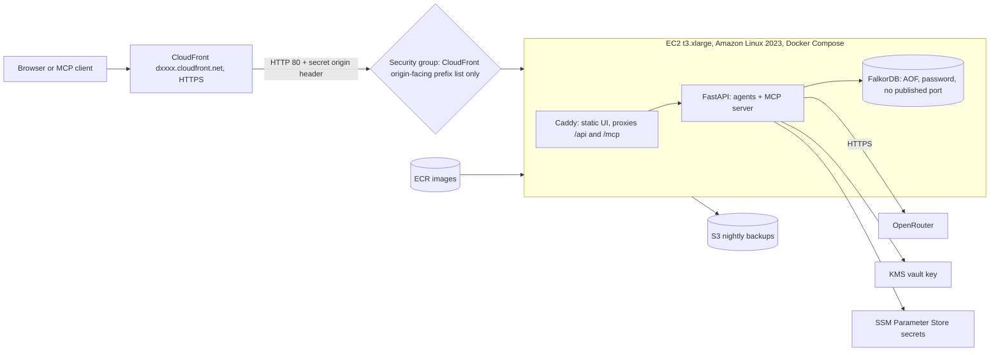

# FinanceBrain architecture

This is a walkthrough of how FinanceBrain is put together and why. Every component below maps to code in this repo. The graph model is in [DATA_MODEL](DATA_MODEL.md), every Cypher query is in [CYPHER](CYPHER.md), verified FalkorDB/OpenRouter behaviour is in [FALKORDB_NOTES](FALKORDB_NOTES.md), and measured results are in [the eval summary](../evals/results/SUMMARY.md).

## 1. Summary

FinanceBrain is a multi-agent "company brain" for a synthetic finance firm. It ingests seven kinds of synthetic company data: email, Slack, tickets, docs/policies, meeting transcripts, CRM notes and a transaction ledger. It pseudonymizes PII **before** anything is written to the graph or sent to a model. It then lets agents answer questions with cited sources, investigate fraud and propose actions behind a human approval step, remember each visitor across sessions, and hand work to each other through shared graph state.

**FalkorDB is the only datastore.** It holds the knowledge graph, vector and full-text indexes, per-visitor memory graphs, the task blackboard, ACL edges, and (in the same Redis server) the encrypted PII token vault, rate-limit counters, the daily budget and the guided-answer cache.

```mermaid
flowchart LR
  subgraph Gen[Synthetic data: datagen/]
    W[World model + storylines] --> C[Channel writers: email, Slack, tickets, docs, meetings, CRM, ledger]
  end
  C --> R[Redactor: Presidio + finance recognizers]
  R -->|original values, AES-GCM| V[(Token vault: KMS envelope)]
  R --> X[Extractor: Haiku 5.5, JSON schema]
  X --> ER[Entity resolver]
  ER --> EM[Embedder: voyage-4, 1024d]
  EM --> FB[(FalkorDB: brain__tenant, mem__tenant__persona__visitor, pristine__tenant)]
  FB <--> MCP[MCP tool server: 31 tools, ACL enforced]
  MCP <--> AG[Agents: Concierge, Brain, Investigator, Compliance, Comms, Sentinel, Librarian]
  AG <-->|streaming chat completions| OR[OpenRouter: Claude Opus/Sonnet/Haiku 5.5]
  AG --> API[FastAPI + SSE]
  API --> UI[Next.js static UI]
```

## 2. Why FalkorDB does the real work

| Capability | How FalkorDB provides it | What breaks without it |
|---|---|---|
| Multi-hop reasoning | Cypher traversals: ring detection through shared `PiiToken` nodes, variable-length `DEPENDS_ON` for blast radius, `DECIDED_IN`/`JUSTIFIED_BY`/`SUPERSEDES` for decision trails | The fraud ring, blast radius and decision-trail answers |
| Semantic retrieval | Vector index on `Document`, `Fact`, `MemoryFact` and `Turn` embeddings (1024 dims, cosine) | `search_knowledge`, memory recall |
| Keyword retrieval | Full-text index on document text/title and on names | Hybrid search (reciprocal-rank fusion of vector + full-text + fact vectors) |
| Graph algorithms as agent tools | `algo.WCC`, label propagation, PageRank, betweenness, `algo.SPpaths` / `shortestPath` | `detect_rings`, `key_people`, `find_path` |
| Tenant and user isolation | One graph per tenant (`brain__<tenant>`) and per visitor (`mem__<tenant>__<persona>__<visitor>`) | Tenant isolation and private memory |
| Instant reset | `GRAPH.COPY pristine__<tenant> brain__<tenant>` | The "Reset demo" button and per-question eval isolation |
| Safe agent-written Cypher | `GRAPH.RO_QUERY` with a timeout and a row limit | `run_cypher_readonly` (the database itself refuses writes) |
| Access control | `CAN_ACCESS` / `ON_DEAL_TEAM` edges checked inside every retrieval query | The information barrier |
| Coordination | `Task`, `Case`, `Action` nodes and `HANDED_OFF_TO` edges in the tenant graph | Investigator to Compliance handoff, the Agents view |
| Operational state | Redis keys in the same server: `vault:<tenant>`, `fb:rl:*`, `fb:budget:<date>`, `fb:guided:*` | PII reveal, rate limits, budget, cached guided answers |

## 3. Lifecycle of one chat turn

1. **Visitor identity.** The browser gets a signed visitor-id cookie. It names the visitor's private memory graph `mem__<tenant>__<persona>__<visitor>`.
2. **Guardrails** (`backend/api/guardrails.py`). Per-IP rate limits are keyed on `CloudFront-Viewer-Address` (chat 20, ops 40 and `/mcp` 300 requests per 10 minutes; the MCP limit is a pure ASGI middleware so streamed responses are not buffered). External MCP clients get a 24-hour read-only token from `POST /api/mcp/token`. A global daily USD budget is fed by OpenRouter's per-response cost accounting. "Try these" questions are served from a guided-answer cache keyed by tenant, persona and question. Over budget, only cached guided answers are served.
3. **Session** (`backend/agents/session.py`, `run_session`). The question is scrubbed for raw PII (`pii_masked` event). Memory context is loaded from the visitor's graph (`memory_context`). If the agent is `auto`, the Concierge picks a specialist (`route`).
4. **Agent loop** (`backend/agents/runtime.py`, `run_agent`). This is a hand-rolled streaming tool loop on OpenRouter with `tool_choice: "auto"` and at most 8 steps. Tools are discovered from our MCP server and converted to OpenAI-format function definitions. Independent tool calls in one step run concurrently. Each step emits `start`, `step`, `tool_call` and `tool_result` events; the result carries the Cypher trace: query name, Cypher, parameters, row count, returned ids and ms.
5. **Actions and handoffs.** Investigation tools write `Case`, `Action` and `Task` nodes (`ops` events). A handoff (for example Investigator to Compliance) creates a `Task` with `HANDED_OFF_TO` and the orchestrator (`backend/agents/orchestrator.py`) starts the next agent (`handoff` event). Proposed actions (freeze account, file SAR) only take effect after a human clicks Approve in the Investigations view.
6. **Answer.** The `final` event carries the text, numbered citations, an `evidence` subgraph (nodes and edges), tool calls, steps, usage and cost. **Only documents that a tool actually returned count as citations.** Any other cited id is reported in `unverified_citations`.
7. **Memory.** The Turn is stored with `USED_EVIDENCE` references (`memory` event). After the session the Librarian (Haiku) consolidates it into `MemoryFact` and `Playbook` nodes. The stream ends with `done`. SSE heartbeats every 10 s keep CloudFront's 60 s origin timeout from cutting long runs.

## 4. Privacy pipeline and information barrier

**Redaction before ingestion** (`backend/redaction/`):

- Presidio + spaCy, plus custom recognizers with validators: Luhn for cards, the ABA checksum for routing numbers, mod-97 for IBANs, and patterns for SSNs, phones and emails. A deny-list of client names comes from CRM records.
- Values are replaced by **consistent tokens** such as `⟨PHONE_0042⟩` (an HMAC of the normalized value maps to a per-tenant sequence number). Each token becomes a `PiiToken` node linked by `HAS_IDENTIFIER`. Shared identifiers therefore become **graph structure without exposing values**: the five-client fraud ring is found by hopping through shared phone, address and device tokens, and no one ever sees a phone number.
- **Token vault:** AES-GCM ciphertexts live in a Redis hash, and the data key is wrapped with AWS KMS (envelope encryption; local key in dev). Only the Compliance officer persona has the `reveal` scope, and every reveal is logged as an `Action`.
- **Canary scan:** every string property of every graph is scanned for raw SSN, card, IBAN, routing, phone and email patterns plus client names. The result must be 0 hits; it is shown in the UI and the eval report.
- **Outbound guard** (`backend/llm/guard.py`): every prompt and embedding input is checked before it leaves the process. Raw PII blocks the call.

**Information barrier.** Project Falcon is MNPI. Its documents are reachable only through `CAN_ACCESS` and `ON_DEAL_TEAM` edges, and the check runs **inside the Cypher** of every retrieval tool, so the LLM never receives what the persona cannot see. For anyone outside the deal team and Compliance, the deal cannot be resolved by id or name, and names that would betray it (such as the deal channel) come back as `⟨restricted⟩` from structural queries. Compliance staff (the control room) can see that the deal exists. Reading the deal documents needs the audit-logged surveillance path used by the Compliance agent.

## 5. Agents and handoffs

| Agent | Model (OpenRouter) | Role |
|---|---|---|
| Concierge | Sonnet 5.5 | Routes each request and loads memory |
| Brain | Sonnet 5.5 | Company Q&A with citations and an evidence subgraph |
| Investigator | Opus 5.5 | Fraud, AML and barrier investigations; opens cases and proposes actions |
| Compliance | Sonnet 5.5 | Barrier checks and SAR drafting; takes over cases |
| Comms | Sonnet 5.5 | Drafts emails and Slack messages |
| Sentinel | Haiku 5.5 | Scans live-feed data and opens cases or alerts |
| Librarian | Haiku 5.5 | Consolidates sessions into memory facts and playbooks |

Handoffs go through the **blackboard in the tenant graph**, not through hidden prompt state. The Investigator calls `handoff`, which creates a `Task` linked to the `Case` with a `HANDED_OFF_TO {note, ts}` edge. The Compliance agent then claims the task (`CLAIMED_BY`) and continues from the case evidence. The Agents view renders this timeline straight from the graph.

## 6. Memory model

Each visitor gets a private graph per tenant and persona:

- **Episodic:** `Session` and `Turn` nodes (`HAD_SESSION`, `HAS_TURN`), with turn embeddings and `USED_EVIDENCE` links. This lets the agent answer "what did I ask you last time?".
- **Semantic:** `MemoryFact` and `Preference` nodes (for example "prefers short bullet points"), written by `remember` or the Librarian. They refer to company entities by stable id through `EntityRef`.
- **Procedural:** `Playbook` and `Step` nodes (`NEXT_STEP`), found with `find_playbook`.

The Memory view shows all of this and has a **Forget** control that deletes the visitor's graph. Persistence comes from FalkorDB AOF (`appendfsync everysec`) on the instance's EBS volume, plus nightly BGSAVE copies to S3.

## 7. Keeping knowledge current

- The corpus is split at a **cutoff of 2026-10-01**. The seed loads everything before it. The **live feed** (`backend/ingest/live.py`) replays later days through the same pipeline: redact, extract, resolve, embed, write.
- New events include a second ring wire, a Slack leak about Falcon, the KYC ownership transfer, an expert's resignation and the reversal of the crypto decision.
- **Facts are bitemporal.** A contradicting fact closes the old one with `valid_to` and links them with `SUPERSEDES`. Nothing is deleted, so `who_owns(as_of=...)` can answer "who owned it in August?" as well as "who owns it now?".
- `KNOWS_ABOUT` weights (derived from authorship and mentions, with recency decay) are recomputed incrementally. This is how "who knows" diverges from the formal `OWNS` edge.
- After each replayed day the **Sentinel** scans the new data and opens or reuses cases. Replaying a day again does not duplicate them.

## 8. Deployment

Security is layered:

1. The security group admits port 80 only from CloudFront's origin-facing managed prefix list.
2. Caddy returns 403 to any request without the secret `X-Origin-Secret` header that CloudFront adds.
3. FalkorDB's port is never published outside the compose network, and it requires a password.
4. Secrets (OpenRouter key, FalkorDB password, origin secret, HMAC keys, demo MCP token) are SSM SecureStrings. The deploy writes them to a mode-600 env file on the instance.
5. The vault data key is wrapped by KMS (`alias/financebrain-vault`).
6. The instance role allows only SSM, ECR read, CloudWatch Logs, its own parameters, the vault key and the backup bucket, with no Bedrock permissions. There is no SSH key; all access is through SSM.

The scripts in `infra/` are idempotent AWS CLI bash:

| Script | Purpose |
|---|---|
| `00_check.sh` | Identity, region and OpenRouter credit check |
| `10_base.sh` | IAM, KMS, SSM, S3, ECR, security group, EC2 and Elastic IP |
| `20_cdn.sh` | CloudFront distribution and behaviors |
| `30_deploy.sh` | Build and push images, deploy via SSM Run Command, invalidate CloudFront |
| `40_seed.sh` | KMS-mode redaction, offline seed from the committed extraction and embedding cache (no LLM cost), `pristine__` snapshots |
| `50_smoke.sh` | Instance smoke test: one call per model and one 1024-dim embedding |

## 9. Key design decisions

| Decision | Alternative | Why |
|---|---|---|
| OpenRouter for all LLM and embedding calls | Amazon Bedrock | Bedrock blocked us: Claude 5.5 returned "not available for this account" even after the use-case form, and the account's applied quotas for Claude 5.5 and Cohere Embed v4 were 0. OpenRouter also gives per-response USD cost for the budget guard. |
| `voyageai/voyage-4` embeddings, 1024 dims | Cohere Embed v4 / Titan | Not offered on OpenRouter. The fallback `openai/text-embedding-3-large` at 1024 dims keeps the same index DDL. A `:Meta` node records the model so vectors are never mixed. |
| JSON-schema `response_format` for extraction | Forced tool choice | OpenRouter's Claude 5.5 endpoints don't support forced `tool_choice`. `provider.require_parameters` routes to endpoints that support structured output; otherwise `chat_json` falls back to plain JSON, Pydantic validation and one repair retry. |
| Hand-rolled streaming tool loop | Agent framework | Full control over SSE events, the Cypher trace, citation verification, `reasoning_details` pass-through and step limits, with very little code. |
| Tools served through our own MCP server | Direct function calls | The same 31 ACL-enforced tools serve the in-app agents and external MCP clients such as Claude Desktop, with signed per-call auth. |
| Offline seed from a committed extraction and embedding cache | Re-extract on deploy | Deterministic, free and fast reseeding and resets. Storyline edges are also seeded from ground truth so demos don't depend on extraction variance. |
| Single EC2 + Docker Compose behind CloudFront | ECS / managed services | Simplest thing that is secure and reproducible in a hackathon timeframe; one instance comfortably serves the demo. |
| Next.js static export served by Caddy | Next.js server | No Node server in production; the UI is plain files plus SSE to the API. |

## 10. Known limitations

- **Single node.** One FalkorDB instance on one EC2 host. There is AOF plus nightly S3 snapshots, but no replication or failover.
- **Synthetic data only.** Storylines are designed, and recall numbers are measured against our own injected ground truth.
- **LLM variance.** Extraction and answers can vary between runs. Mitigations: storyline edges seeded from ground truth, citation verification, and a golden-question eval with an LLM judge.
- **Single-worker API.** Concurrency comes from asyncio rather than multiple processes; the load test measures the database layer directly.
- **Demo-grade auth.** Personas are switchable in the UI, which is intentional for the demo. Real deployments would bind personas to an identity provider; MCP tokens are already signed and scoped.
