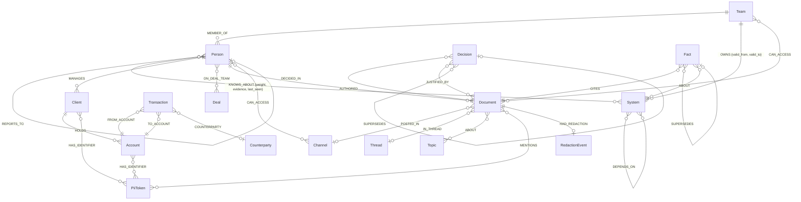

# Graph data model

FinanceBrain keeps **everything** in FalkorDB: knowledge graph, vectors, full-text indexes, PII token structure,
ACLs, agent memory, and the agent coordination blackboard. This page describes the graphs as built by
`backend/graph/schema.py` and `backend/ingest/pipeline.py`. Every query is listed in [CYPHER.md](CYPHER.md),
which is generated from `backend/graph/queries.py`.

## Graph topology (one FalkorDB instance, many graphs)

| Graph | Contents | Written by |
|---|---|---|
| `brain__<tenant>` | Org, systems, clients/accounts/transactions (tokens only), documents, topics, facts, decisions, PII tokens, ACL edges, cases/tasks/actions, playbooks, `:Meta` | ingestion, live feed, agents |
| `mem__<tenant>__<user>` | One user's private memory: sessions, turns, memory facts, entity refs, preferences | Librarian and agents, for that user only |
| `pristine__<tenant>` | `GRAPH.COPY` of the freshly seeded brain; "Reset demo" copies it back | `backend/ingest/seed.py` |

Tenants (`halcyon`, `brightwater`) never share a graph, so isolation is a property of *which graph a query
runs on*, decided server-side from the auth context and never by the model.

## Node labels (brain graph)

| Label | Key properties | Source |
|---|---|---|
| `Person` | id, name, title, email (work), team_id, start_date, end_date | world model (salary, home address and medical notes are **not** ingested) |
| `Team` | id (`team_ops`), name | world model |
| `System` | id (`sys_reconlegacy`), name, description, tier | world model |
| `Client` | id, name (= `⟨CLIENT_NAME_NNNN⟩` token), segment, risk_rating, kyc_status | world model, tokens only |
| `Account` | id, kind, number (= token), opened, status | world model, tokens only |
| `Counterparty` | id, name, country, bank | world model; bank identifiers are tokens |
| `Transaction` | id, ts, amount, currency, kind, memo, fraud_score | ledger (pre-cutoff at seed, the rest via live feed) |
| `Deal` | id, codename, kind, target, status, sensitivity (`MNPI`) | world model |
| `Channel` | id, name, private | world model |
| `Document` | id, kind (email, slack, ticket, doc, meeting, crm), ts, title, text (**redacted**), sensitivity, public, live_feed, doc_type, ticket_key/status/priority, redactions (JSON), embedding (1024-d) | redacted corpus |
| `Thread` | id | Slack/email threading |
| `Topic` | id (`topic_wire_fraud_alert`), name, embedding | LLM extraction, canonicalised by embedding similarity (cosine ≥ 0.86) |
| `Fact` | id, subject_id, predicate, object, object_key, statement, valid_from, valid_to, confidence, embedding | LLM extraction (bitemporal) |
| `Decision` | id, title, status, effective, summary | decision log + LLM extraction |
| `PiiToken` | id (= token, e.g. `⟨PHONE_0042⟩`), type | redaction vault; the raw value lives only in the encrypted vault |
| `RedactionEvent` | id, counts (JSON) | redaction pipeline audit trail |
| `Agent`, `Task`, `Case`, `Action`, `Playbook`, `Step` | id, status, ... | agents at runtime (items 6–8) |
| `Meta` | embed_model, embed_dims, schema_version, tenant | `ensure_meta` refuses to mix vector spaces |

Memory graph labels: `User`, `Session`, `Turn` (text, ts, embedding), `MemoryFact` (text, embedding),
`EntityRef` (points at a brain `id` by value), `Preference`.

## Relationship types

| Group | Types |
|---|---|
| Org | `MEMBER_OF`, `REPORTS_TO`, `OWNS {valid_from, valid_to}` (Team or Person → System), `MANAGES` (relationship manager → Client) |
| Derived expertise | `KNOWS_ABOUT {weight, evidence, last_seen}` (Person → System, Client, Deal, Topic, Counterparty) |
| Systems | `DEPENDS_ON` |
| Communication | `AUTHORED`, `SENT_TO`, `ATTENDED`, `POSTED_IN`, `IN_THREAD`, `REPLY_TO`, `ASSIGNED_TO`, `MENTIONS`, `ABOUT` |
| Knowledge | `DECIDED_IN`, `JUSTIFIED_BY`, `CITES`, `SUPERSEDES` (Decision→Decision, Fact→Fact) |
| Finance | `HOLDS`, `FROM_ACCOUNT`, `TO_ACCOUNT`, `COUNTERPARTY`, `ON_DEAL_TEAM` |
| Privacy | `HAS_IDENTIFIER` (Client, Account, Counterparty → PiiToken), `HAD_REDACTION` |
| Access | `CAN_ACCESS` (Person → Channel, Person → Document, Team → Document) |

## How the graph does the work

### Shared identifiers become structure, without exposing values
Two clients with the same phone number both get `HAS_IDENTIFIER` edges to **one** `⟨PHONE_NNNN⟩` node, because
tokenisation is deterministic per tenant (HMAC of the normalised value). A fraud ring is therefore a connected
component over `Client–PiiToken–Client` paths. It is found by Cypher traversal or `algo.WCC`, and no raw phone,
address or device id is ever stored or sent to an LLM. The resolver deliberately refuses to map a shared token to
any *single* client.

### Access control is traversal
A persona may read a `Document` if it is `public`, or if any of these paths exist:
`(Person)-[:CAN_ACCESS]->(Document)`, `(Person)-[:MEMBER_OF]->(Team)-[:CAN_ACCESS]->(Document)`, or
`(Person)-[:CAN_ACCESS]->(Channel)<-[:POSTED_IN]-(Document)`. MNPI documents (deal codenames) are never public.
They are reachable only by deal-team members, so an information-barrier breach shows up as an MNPI document
posted in a channel whose `CAN_ACCESS` set includes people outside `ON_DEAL_TEAM`.

### Bitemporal knowledge
- `OWNS` edges carry `valid_from` / `valid_to`, and successive owners are separate edges, so
  `who_owns(system, as_of)` is a single interval filter.
- Extracted `Fact`s are reified with `valid_from` / `valid_to`. For *functional* predicates (`owned_by`,
  `maintained_by`, `status`, `assigned_to`, `deadline`, `role`), a later fact with a different object closes the
  earlier one and adds `SUPERSEDES`. Restating the same value does not close it, and nothing is deleted.
- Decisions chain the same way: `dec_crypto_resume -[:SUPERSEDES]-> dec_crypto_pause`.

### Derived expertise (`KNOWS_ABOUT`)
Each participant in a document gains weight toward every entity the document is about. The gain is
`role_weight × 0.5^(age_days / 45)`, with ages measured from the demo's "today", 2026-10-15. Each person counts
once per document, with their strongest role, and roles follow **intent rather than volume**:

| Role | Weight | Signal |
|---|---|---|
| `answered` (a reply to *someone else's* question) | 2.0 | knows the answer |
| `documented` (author of a runbook, architecture doc, procedure, model card, ...) | 2.0 | wrote it down |
| `assignee` (ticket) | 1.2 | trusted to fix it |
| `author` (other messages, tickets, memos) | 1.0 | works on it |
| `asked_of` (@-mentioned in, or emailed, a question) | 1.0 | the organisation treats them as the expert |
| `attendee` | 0.5 | was in the room |
| `asked` (author of a question) | 0.3 | needs to know, which is not the same as knowing |
| `mentioned` | 0.3 | referenced |
| `recipient` | 0.15 | was informed |

Why intent matters: on the first seed, with volume-style weights, the top "expert" on ReconLegacy was a
reconciliation analyst who *uses* it daily and asks about it constantly (11 questions, 2 answers). The engineer
who actually maintains it answered 9 questions and asked none. With intent weights she ranks first. Each edge also
carries `answered`, `asked` and `documented` counters, so `who_knows` can explain its ranking ("answered 9
questions about ReconLegacy").

Weights accumulate incrementally (`ON CREATE SET … SET k.weight = k.weight + r.w`), so the live feed updates
expertise without a rebuild. Contrast this with formal `OWNS`. ReconLegacy is formally owned by the Director of
Engineering, but the knowledge sits with one Staff Engineer whose last day is 2026-10-09. The bus-factor demo is
the gap between "who owns X" and "who actually knows X".

### Seed cut and live feed
The seed loads the world **as of the cutoff** (2026-10-01): pre-cutoff documents and transactions, ownership
intervals and employment as they stood then. Later events stay out of the graph until the live feed replays them
through the same pipeline. These are the KYC ownership transfer (10-06), the recon expert's departure (10-09),
the second ring wire, the Falcon leak and the crypto-onboarding reversal (10-12).

## Indexes and constraints

| Kind | Brain graph | Memory graph |
|---|---|---|
| Range | `id` on every label; `Document.ts/kind/thread_id/ticket_key`; `Transaction.ts`; `Fact.subject_id/predicate/valid_from`; `PiiToken.type`; `Person.name/team_id`; `Task/Case/Action.status`; edge `OWNS.valid_from`, `KNOWS_ABOUT.weight` | `id` on every label; `Session.started`; `Turn.ts` |
| Unique | `id` on every label (`GRAPH.CONSTRAINT … UNIQUE NODE <Label> PROPERTIES 1 id`) | same |
| Full-text | `Document(title, text)`, `Person(name, title)`, `System(name, description)`, `Topic(name)`, `Deal(codename, target)`, `Fact(statement)` | `MemoryFact(text)`, `Turn(text)` |
| Vector (1024-d, cosine) | `Document.embedding`, `Fact.embedding`, `Topic.embedding` | `MemoryFact.embedding`, `Turn.embedding` |

Embeddings come from `voyageai/voyage-4` via OpenRouter, run on redacted text only. They are cached in
`data/extracted/embeddings/`, so reseeding makes no embedding calls.

## FalkorDB constraints we design around

- Map-valued properties are rejected, so nested data (`redactions`, `counts`) is stored as JSON strings.
- Null properties are not stored, so absent values are simply omitted (`clean_props`).
- Labels cannot be parameters, so per-label query variants are generated from one template and registered as
  `NAME[Label]`.
- Vector `queryNodes` returns cosine *distance* (lower is better), and ACL filtering after `YIELD` is a post-filter,
  so retrieval over-fetches before filtering.
